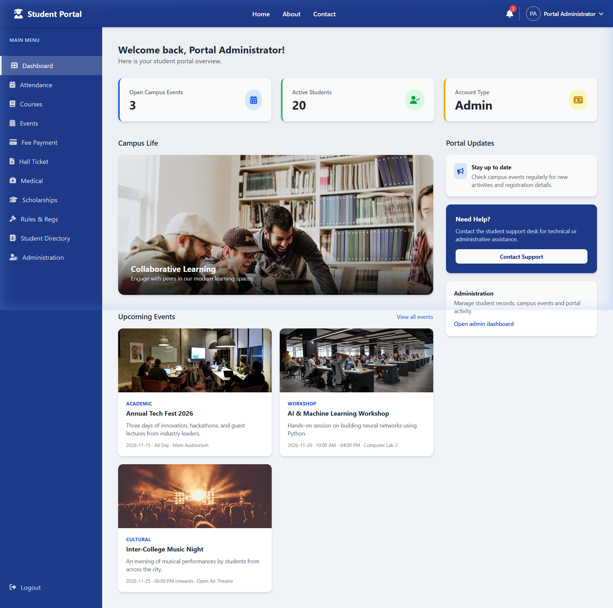
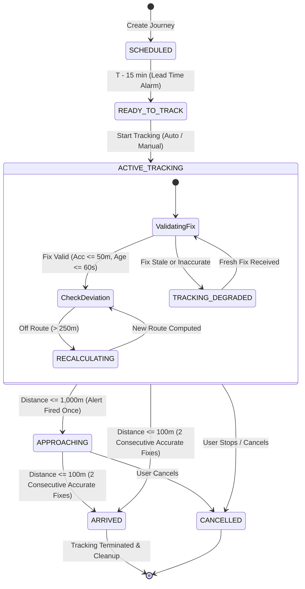

<div align="center">



# ADA Smart Alarm
### Destination-Aware Commute Alarm & Dynamic Journey Tracking Platform

[](android/)
[](apps/mobile/)
[](packages/shared/)
[](backend/)
[](backend/)
[](backend/)
[](backend/)
[](docs/MOBILE_TEST_PLAN.md)
[](LICENSE)

<br/>

**A mission-critical, destination-aware smart alarm and live journey monitoring platform.**  
*Schedule when you must arrive; ADA determines when you need to wake up and leave, monitors road traffic in real time, begins GPS tracking before departure, adapts dynamically to unexpected delays, alerts you as you approach, and confirms your arrival.*

</div>

---

## 📖 Table of Contents

- [The Core Problem ADA Solves](#-the-core-problem-ada-solves)
- [How ADA Works](#-how-ada-works)
  - [The Calculation Contract](#the-calculation-contract)
  - [Journey State Machine](#journey-state-machine)
  - [Dynamic ETA & Rerouting Rules](#dynamic-eta--rerouting-rules)
- [System Architecture](#-system-architecture)
  - [Repository Layout](#repository-layout)
  - [Platform Implementation Map](#platform-implementation-map)
- [Step-by-Step Demo Guide](#-step-by-step-demo-guide)
- [Installation & Setup Guide](#-installation--setup-guide)
  - [Backend & Database Setup (macOS / Linux / Windows)](#1-fastapi-backend--database-setup)
  - [Native Android Application Setup](#2-native-android-application-setup-android)
  - [Cross-Platform Mobile App Setup (iOS & Android via Expo)](#3-cross-platform-mobile-application-setup-appsmobile)
- [Testing & Quality Assurance](#-testing--quality-assurance)
- [Security, Privacy & Background Policy](#-security-privacy--background-policy)
- [Documentation Index](#-documentation-index)

---

## 🎯 The Core Problem ADA Solves

Traditional alarm clocks suffer from a fatal design flaw: **they are blind to the real world.**

If you need to reach an exam, flight, or critical meeting by 9:00 AM:
1. A conventional alarm wakes you at a fixed time (e.g. 7:00 AM) even if an overnight accident doubled your commute.
2. If traffic is unusually light, you waste hours sitting idle.
3. If traffic builds up, you arrive late.
4. Once you step out of the door, traditional alarms do nothing—they cannot warn you if you take a wrong turn or alert you before your stop.

### The 5 Questions ADA Answers:
1. **When must I reach my destination?** (*Your required arrival deadline*)
2. **How long will the journey take today?** (*Live traffic and weather-aware commute estimation*)
3. **When should I leave?** (*Departure time dynamically adjusted for safety buffers*)
4. **When should I wake up?** (*Wake-up time adjusted for your personal morning routine*)
5. **Is my planned arrival still achievable right now?** (*Continuous GPS tracking, route deviation detection, and arrival alerts*)

---

## ⚙️ How ADA Works

### The Calculation Contract

ADA's scheduling engine works backwards from your arrival deadline through deterministic mathematical formulas:

```
[Required Arrival Time]  (e.g., 9:00 AM)
         │
         ▼  minus Safety Buffer Margin (e.g., 15 min)
[Planned Arrival Time]   (8:45 AM)
         │
         ▼  minus Live Commute Travel Duration (e.g., 45 min live traffic)
[Recommended Leave Time] (8:00 AM)
         │
         ▼  minus Morning Routine Preparation Time (e.g., 30 min)
[Recommended Wake Time]  (7:30 AM) ──> Alarm Manager Schedules Wake-Up Ring
```

$$\text{PlannedArrivalTime} = \text{RequiredArrivalTime} - \text{SafetyBuffer}$$
$$\text{RecommendedLeaveTime} = \text{PlannedArrivalTime} - \text{TravelDuration}_{\text{traffic}}$$
$$\text{RecommendedWakeTime} = \text{RecommendedLeaveTime} - \text{PreparationDuration}$$

---

### Journey State Machine

From initial creation through confirmed arrival, ADA transitions through a validated deterministic state machine:



---

### Dynamic ETA & Rerouting Rules

ADA implements strict invariants ported across native Kotlin ([DynamicEtaEngine.kt](android/app/src/main/kotlin/com/thinkx/ada/domain/journey/engine/DynamicEtaEngine.kt)) and pure TypeScript ([DynamicEtaEngine.ts](packages/shared/src/engine/DynamicEtaEngine.ts)):

1. **Zero Double-Counting of Travel Time:**
   $$\text{PredictedArrivalEpochMs} = t_{\text{fix}} + (\text{RemainingDurationSeconds} \times 1,000)$$
   *Elapsed journey time is never added twice, and static stop penalties are never superimposed onto live provider traffic durations.*
2. **GPS Velocity Jump Protection:**
   Rejects unrealistic GPS jumps ($v > 45\text{ m/s} \approx 162\text{ km/h}$) unless accuracy is exceptionally high ($< 15\text{m}$), shielding against urban GPS reflections.
3. **Route Recalculation Hysteresis:**
   - Provider request cooldown: Minimum 30 seconds between requests.
   - Immediate recalculation when cross-track corridor deviation exceeds **250 meters**.
   - Routine recalculation when displacement $\ge 200\text{m}$ and elapsed time $\ge 180\text{s}$, or if previous route is stale ($> 300\text{s}$).
4. **Multi-Stage Proximity Alerts:**
   - **Approaching Alert:** Triggers once when remaining distance $\le 1,000\text{ meters}$.
   - **Arrival Confirmation:** Confirmed when remaining distance $\le 100\text{ meters}$ across **2 consecutive accurate fixes** ($\le 50\text{m}$ accuracy). Cleanly stops tracking upon arrival.

---

## 🏛️ System Architecture

ADA is engineered as a production-grade multi-platform system:

```
┌─────────────────────────────────────────┐  ┌──────────────────────────────────────────┐
│     Native Android (Kotlin + Compose)   │  │   Cross-Platform Mobile (React Native)   │
│            [android/]                   │  │              [apps/mobile/]              │
│   Package: com.thinkx.ada (Preserved)   │  │    Bundle ID: com.thinkx.ada.mobile      │
│   • AlarmManager.setAlarmClock()        │  │    • iOS Background Location Tracking    │
│   • Foreground Location Service         │  │    • Hardware Keystore (expo-secure-store)│
│   • Room SQLite Database v3             │  │    • Native Local Notifications          │
└────────────────────┬────────────────────┘  └─────────────────────┬────────────────────┘
                     │                                             │
                     └──────────────────────┬──────────────────────┘
                                            │
                                            ▼
                     ┌─────────────────────────────────────────────┐
                     │       Shared TypeScript Domain Core         │
                     │             [packages/shared/]              │
                     │   • Pure DynamicEtaEngine (1:1 with Kotlin) │
                     │   • Polyline decoder & Haversine distance   │
                     │   • Journey state machine & typed DTOs      │
                     └──────────────────────┬──────────────────────┘
                                            │
                                            ▼
┌────────────────────────────────────────────────────────────────────────────────────────┐
│                              FastAPI Backend Gateway [backend/]                        │
│   • Google Maps & Mapbox live traffic routing proxy with Redis 5-minute caching        │
│   • Offline Great-Circle heuristic fallback routing                                    │
│   • Firebase Admin token verification & user claims                                    │
│   • PostgreSQL 15 + SQLAlchemy 2.0 with idempotent sync (X-Idempotency-Key)            │
└────────────────────────────────────────────────────────────────────────────────────────┘
```

### Repository Layout

```
├── android/            # Native Kotlin + Jetpack Compose Android app (com.thinkx.ada)
├── apps/
│   └── mobile/         # Cross-platform React Native + Expo app (com.thinkx.ada.mobile)
├── packages/
│   └── shared/         # Reusable pure TypeScript domain math, models, and state machine
├── backend/            # FastAPI, PostgreSQL, Redis, routing proxy, and Celery workers
├── frontend/           # React 19 + Vite web dashboard
└── docs/               # Architecture runbooks, iOS setup, test plans, and release guides
```

---

## 🎬 Step-by-Step Demo Guide

Experience how ADA handles a real-world commute from **Ahmedabad to Charusat University (Anand)** with an arrival deadline of **9:00 AM**:

```
[07:00 AM] Scheduled Departure Planned
   │
   ├── [07:15 AM] Alarm Wake-Up: ADA sounds alarm based on 45m commute + 15m safety buffer + 45m prep
   ├── [07:45 AM] (T - 15m): ADA automatically wakes device; initiates Background Location Tracking
   ├── [08:00 AM] Departure: User begins drive; persistent notification displays live dynamic ETA
   ├── [08:20 AM] Road Incident: Heavy traffic on NH48; ETA dynamically recalculates from 8:45 AM to 8:58 AM
   ├── [08:35 AM] Detour Taken: User turns off route; deviation > 250m detected; instant reroute triggered
   ├── [08:52 AM] Approaching: User reaches 1,000m perimeter; "Approaching Destination" alert sounds
   └── [08:58 AM] Arrival: User enters 100m geofence (2 consecutive GPS fixes); "Arrived!" alert sounds,
                          tracking automatically terminates, releasing GPS & battery resources.
```

### Trying the Interactive Demo via Code:
1. **Shared Math Engine:** Run `vitest run packages/shared/__tests__` to see all 14 mathematical invariants tested against the canonical Charusat scenario.
2. **Mobile Tracking Engine:** Run `vitest run apps/mobile/__tests__` to observe simulated GPS fixes triggering approaching alerts and 2-hit arrival confirmations.
3. **Backend Proxy:** Run `python -m pytest backend/tests/test_location_and_routing.py` to see route resolution and traffic duration separation.

---

## 🛠️ Installation & Setup Guide

### 1. FastAPI Backend & Database Setup
Works identically on **macOS**, **Linux**, and **Windows**:

#### Prerequisites:
- Python 3.10+
- Docker & Docker Compose (for PostgreSQL and Redis)

```bash
# Clone the repository
git clone https://github.com/buildwithneel/ADA-Smart-Alarm.git
cd ADA-Smart-Alarm

# 1. Start PostgreSQL 15 and Redis 7 in the background
docker-compose up -d postgres redis

# 2. Configure Backend Environment
cd backend
cp .env.example .env

# 3. Create Virtual Environment & Install Dependencies
# On macOS / Linux:
python3 -m venv .venv
source .venv/bin/activate
pip install -r requirements.txt

# On Windows (PowerShell):
python -m venv .venv
.venv\Scripts\Activate.ps1
pip install -r requirements.txt

# 4. Run Database Migrations
alembic upgrade head

# 5. Start the FastAPI Development Server
python -m uvicorn app.main:app --reload --host 0.0.0.0 --port 8000
```
*API Swagger Documentation will be available at [http://localhost:8000/docs](http://localhost:8000/docs).*

---

### 2. Native Android Application Setup (`android/`)
*The native Kotlin + Jetpack Compose application (`com.thinkx.ada`).*

#### Prerequisites across OSes:
- **macOS / Linux / Windows**: JDK 17, Android Studio (Ladybug or newer), Android SDK 36, Build-Tools 36.0.0.

```bash
cd android

# On macOS / Linux:
./gradlew testDebugUnitTest
./gradlew assembleDebug

# On Windows (PowerShell):
.\gradlew.bat testDebugUnitTest
.\gradlew.bat assembleDebug
```

#### Installing to Physical Phone or Emulator:
```bash
# Ensure device is connected via USB with USB Debugging enabled
adb devices

# Install debug APK
# On macOS / Linux:
adb install -r app/build/outputs/apk/debug/app-debug.apk

# On Windows:
adb install -r app\build\outputs\apk\debug\app-debug.apk
```

> **Networking Notice:** When testing on the Android Emulator, the backend is reachable at `http://10.0.2.2:8000/api/v1`. On a physical phone, connect to the same Wi-Fi network and use your host computer's LAN IP (e.g. `http://192.168.1.50:8000/api/v1`).

---

### 3. Cross-Platform Mobile Application Setup (`apps/mobile/`)
*The React Native + TypeScript Expo application (`com.thinkx.ada.mobile`).*

#### Prerequisites:
- Node.js 20+ or 24+
- npm or yarn

```bash
cd apps/mobile

# Install dependencies
npm install

# Run automated tests
npm test

# Start the Expo development server
npx expo start
```

#### Running by Operating System:

| OS | Android Development | iOS Development |
| :--- | :--- | :--- |
| **macOS** | ✅ Android Emulator or physical device via `npx expo run:android` | ✅ Full iOS Simulator & physical iPhone builds via `npx expo run:ios` and Xcode |
| **Windows** | ✅ Android Emulator or physical device via `npx expo run:android` | ⚠️ UI & logic testable in Expo Go; native iOS Mach-O compilation requires macOS/Xcode |
| **Linux** | ✅ Android Emulator or physical device via `npx expo run:android` | ⚠️ UI & logic testable in Expo Go; native iOS Mach-O compilation requires macOS/Xcode |

---

## 🧪 Testing & Quality Assurance

ADA adheres to an uncompromising testing pyramid. All 280 automated tests are passing:

```bash
# 1. Backend Regression Suite (131 tests)
cd backend
python -m pytest

# 2. Native Android Unit Test Suite (97 tests)
cd android
./gradlew testDebugUnitTest  # (or .\gradlew.bat testDebugUnitTest on Windows)

# 3. Web Client Vitest Suite (29 tests)
cd frontend
npm test

# 4. Shared Core & Mobile Unit Tests (23 tests)
# From project root:
.\frontend\node_modules\.bin\vitest.cmd run --config vitest.config.ts apps/mobile/__tests__ packages/shared/__tests__
```

---

## 🔒 Security, Privacy & Background Policy

- **Zero Hardcoded Secrets:** Private keys, keystores, and Firebase service accounts are never checked into git.
- **Hardware Keystore Storage:** Mobile authentication tokens are stored exclusively in hardware keystores (`expo-secure-store` using iOS Keychain and Android KeyStore). Plaintext `AsyncStorage` is banned.
- **Location Privacy:** Location fixes are collected only during user-authorized active journeys. Reverse geocoding in FastAPI automatically fuzzes coordinates to $\sim 11\text{m}$ resolution.
- **Truthful Battery & OS Constraints:**
  - On **Android**: Runs under `FOREGROUND_SERVICE_LOCATION` with a persistent notification.
  - On **iOS**: Uses `kCLLocationAccuracyBestForNavigation` with `showsBackgroundLocationIndicator`. ADA explicitly informs users that force-closing the app from the iOS App Switcher halts tracking per Apple operating system policy.

---

## 📚 Documentation Index

For comprehensive technical specifications, consult our detailed documentation in `docs/`:

1. [docs/CROSS_PLATFORM_ARCHITECTURE.md](docs/CROSS_PLATFORM_ARCHITECTURE.md) — Multi-platform architecture, directory layout, and endpoint reuse map.
2. [docs/IOS_BACKGROUND_LOCATION.md](docs/IOS_BACKGROUND_LOCATION.md) — Apple Core Location capabilities, `Info.plist` disclosures, and background lifecycle.
3. [docs/MOBILE_DEVELOPMENT_SETUP.md](docs/MOBILE_DEVELOPMENT_SETUP.md) — Comprehensive developer machine setup and networking configuration.
4. [docs/MOBILE_TEST_PLAN.md](docs/MOBILE_TEST_PLAN.md) — Complete 5-tier verification matrix.
5. [docs/IOS_RELEASE_CHECKLIST.md](docs/IOS_RELEASE_CHECKLIST.md) — Apple developer provisioning, privacy nutrition disclosures, and TestFlight release gates.

---

## 📄 License

This project is licensed under the MIT License — see the [LICENSE](LICENSE) file for details.
